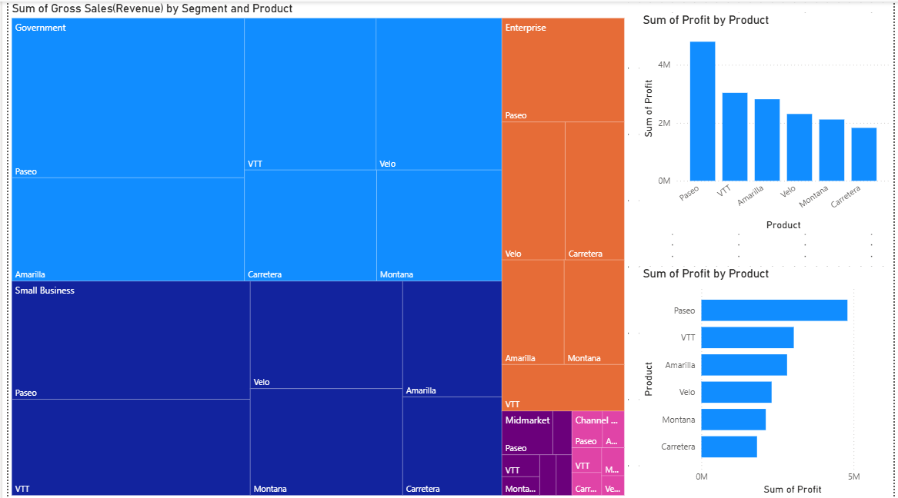
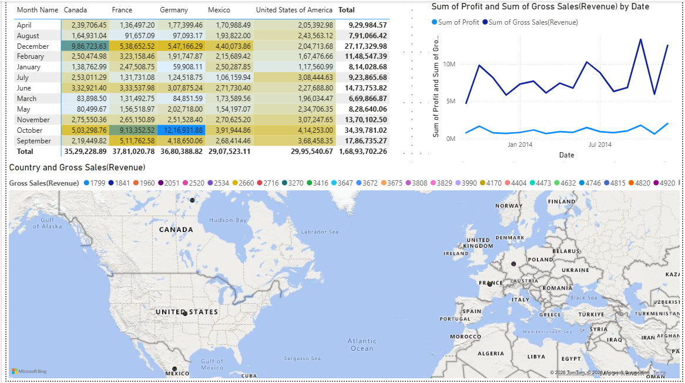

# Sales & Profit Analysis Dashboard (Power BI)

An interactive Power BI report that analyzes product sales, revenue, and profit across segments, countries, and time. It is built on a 700-row sales dataset covering **September 2013 – December 2014**.

## Overview

The report is split into two pages:

| Page | Focus | Visuals |
|------|-------|---------|
| **Page 1 – Product & Segment Performance** | Which products and segments drive profit and revenue | Bar chart, clustered column chart, treemap |
| **Page 2 – Time & Geography** | How profit and revenue change over time and by country | Matrix (pivot table), line chart, map |

### Page 1 – Product & Segment Performance
- **Profit by Product (bar chart):** total profit for each product.
- **Profit by Product (clustered column chart):** the same measure in column form for side-by-side comparison.
- **Revenue Treemap:** Gross Sales (Revenue) grouped by Segment and broken down by Product.

### Page 2 – Time & Geography
- **Profit Matrix:** profit by Month Name (rows) and Country (columns).
- **Profit vs. Revenue Trend (line chart):** Profit and Gross Sales (Revenue) over Date.
- **Revenue Map:** Gross Sales (Revenue) by Country.

## Dataset

Source file: an Excel workbook (`Sheet1`) loaded through Power Query. The column types are set in the query, and no DAX measures or table relationships are defined. All visuals use the built-in aggregations (e.g. `Sum of Profit`).

**Columns**

| Column | Description |
|--------|-------------|
| Segment | Customer segment |
| Country | Country of sale |
| Product | Product name |
| Discount Band | None / Low / Medium / High |
| Units Sold | Number of units sold |
| Manufacturing Price | Cost to manufacture one unit |
| Sale Price | Price per unit |
| Gross Sales (Revenue) | Revenue before discounts |
| Discounts | Discount amount |
| Sales | Sales after discounts |
| COGS (Cost of Goods Sold) | Cost of goods sold |
| Profit | Profit for the row |
| Date, Month Number, Month Name, Year | Date fields |

**Dimensions**
- **Segments (5):** Channel Partners, Enterprise, Government, Midmarket, Small Business
- **Countries (5):** Canada, France, Germany, Mexico, United States of America
- **Products (6):** Amarilla, Carretera, Montana, Paseo, VTT, Velo
- **Period:** Sep 2013 – Dec 2014

**Dataset totals**
- Gross Sales (Revenue): ~127.9M
- Profit: ~16.9M
- Units Sold: ~1.13M

## Repository Structure

```
.
├── power_bi_project_1.pbix   # Power BI report
├── data/                     # (optional) source Excel file
├── screenshots/              # (optional) dashboard screenshots
└── README.md
```

## Getting Started

1. Install [Power BI Desktop](https://powerbi.microsoft.com/desktop/) (Windows).
2. Clone or download this repository.
3. Open `power_bi_project_1.pbix`.
4. **Update the data source path.** The report was built against a local Excel file, so on another machine you will need to repoint it:
   - Go to **Home → Transform data → Data source settings**.
   - Click **Change Source…** and select your copy of the Excel workbook.
   - Click **Refresh**.

## Skills Demonstrated

- Importing and typing data with Power Query
- Building bar, column, treemap, matrix, line, and map visuals
- Multi-page report design in Power BI Desktop
- Aggregating profit and revenue across dimensions and time

## Screenshots

### Page 1 – Product & Segment Performance


### Page 2 – Time & Geography

